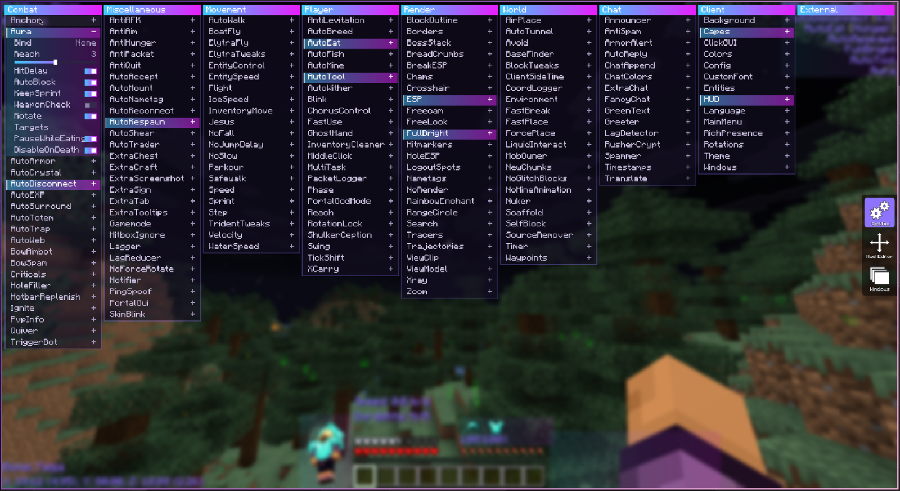
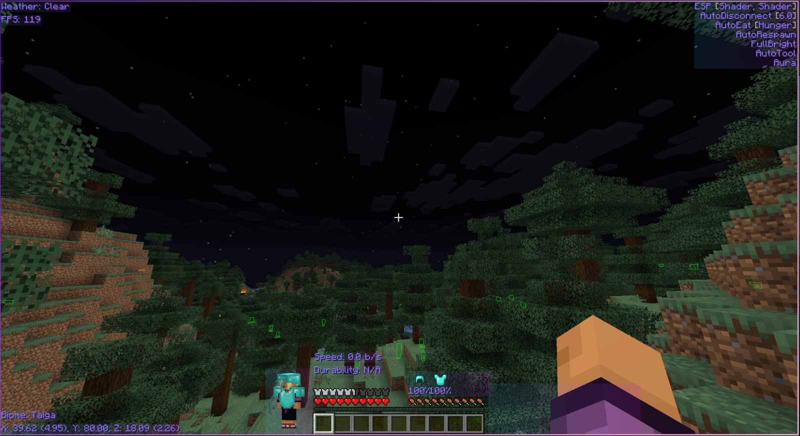
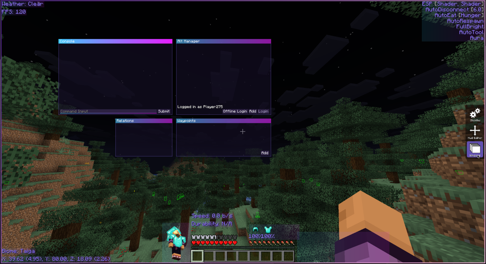

# Astera Theme — RusherHack (1.21.4, 1.21.11, 26.2)

<p align="center">
  
</p>

A clean, Astera client style **ClickGUI theme** for RusherHack. Periwinkle category panels, soft tinted bodies and highlighted rows for enabled modules. It looks just like Astera, but runs on RusherHack.

## Screenshots

**HUD**

<p align="center">
  
</p>

**Windows**

<p align="center">
  
</p>

## Features

- **Astera look**: solid header bar, 1px outline, see-through panel body and filled rows for enabled modules.
- **Adjustable scale**: make the whole GUI bigger or smaller with the `Scale` setting (0.5 – 2).
- **Full color control**: theme color, body/enabled/hover opacity, and text, enabled text, header and value colors.
- **Every setting type**: toggles, sliders, enums/modes, binds, text fields and colors (RGBA, rainbow, sync).
- **Astera category names**: Miscellaneous → Misc, Render → Visual, Client → Core (can be turned off).
- **Draggable panels**: drag a header to move a panel, scroll to move all panels.

## Installation

1. Add the JVM flag `-Drusherhack.enablePlugins=true` to your Minecraft JVM arguments.
2. Download the jar for your Minecraft version (`astera-theme-1.0.0+mc<version>.jar`) from the [Releases](https://github.com/eclipxia/CelestialTheme1.21.11RH/releases) page.
3. Put it in `.minecraft/rusherhack/plugins/`.
4. Launch the game and check that it loaded with `*plugins`.
5. Open the ClickGUI, go to **Core → Theme** and pick **Astera**.

## Usage

| Action | Result |
|---|---|
| Left click a module | Toggle it |
| Right click a module | Show / hide its settings |
| Drag a panel header | Move the panel |
| Right click a panel header | Collapse the panel |
| Mouse wheel | Scroll all panels |
| Left click a bind, then press a key | Set the bind (Esc / Delete / Backspace clears it) |

## Settings

| Setting | Description |
|---|---|
| `Color` | Main theme color (header, outline, highlights) |
| `Scale` | Size of the whole ClickGUI, applied when you release the slider |
| `TextShadow` | Text shadow, off by default like Astera |
| `BodyAlpha` | Opacity of the panel body tint |
| `EnabledAlpha` | Opacity of enabled module rows |
| `HoverAlpha` | Opacity of the hover overlay |
| `TextColor` / `EnabledTextColor` / `HeaderTextColor` / `ValueColor` | Text colors |
| `AsteraNames` | Use Astera category names |
| `ScrollSpeed` | How far the mouse wheel moves the panels |

> Tip: for the closest Astera look, turn on **CustomFont** and pick a thin font.

## Building

Requires JDK 25 (needed by Loom; the 1.21.x modules still target Java 21).

```sh
./gradlew buildAll          # every version
./gradlew build-1.21.11     # a single version (also build-1.21.4, build-26.2)
```

Jars are written to `build/libs/astera-theme-1.0.0+mc<version>.jar`.

## Project layout

- `common/` — all theme code, shared by every version and compiled against each one.
- `version/<mc>/` — one Gradle project per Minecraft version. Anything that differs between versions lives in that module's `Compat` class (`version/<mc>/src/main/java/org/example/astera/Compat.java`): renderer batching, item drawing and background blur.
- `gradle/version.gradle` — build logic shared by the version modules.

To support a new version, add `version/<mc>/` with a `gradle.properties` and `build.gradle`, a `Compat.java`, and include it in `settings.gradle`.
